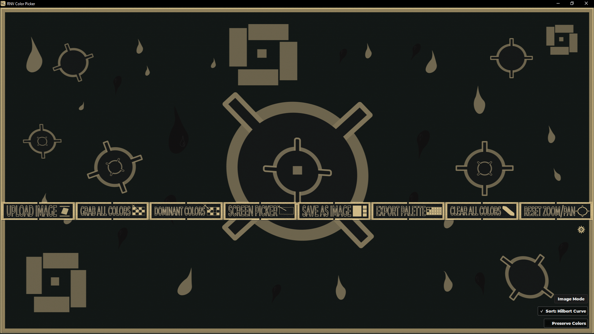
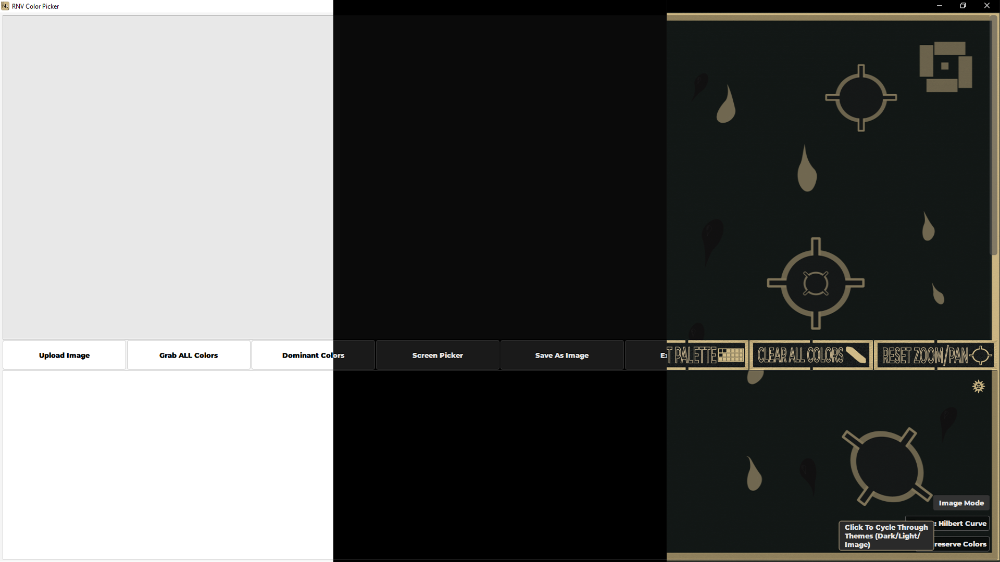
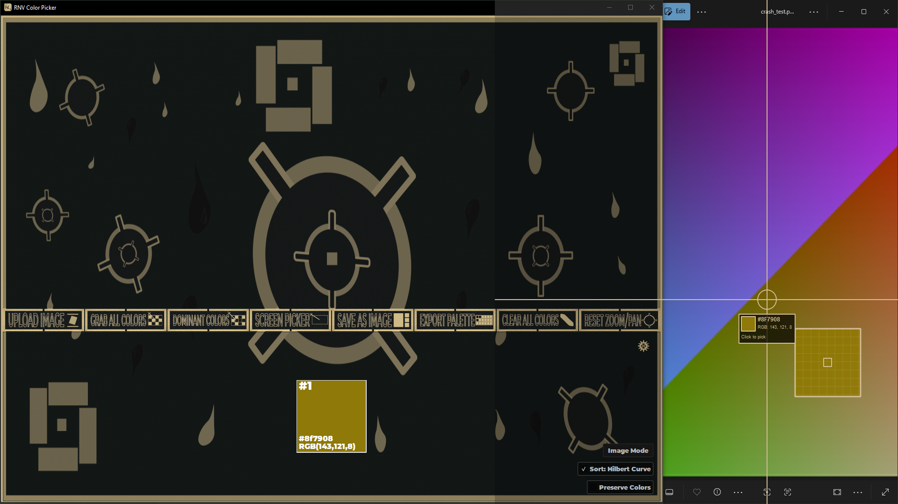
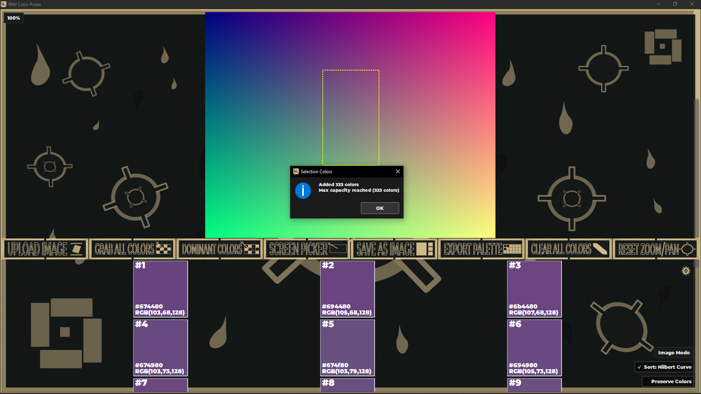
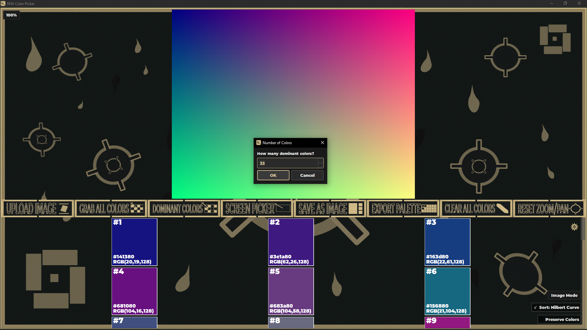
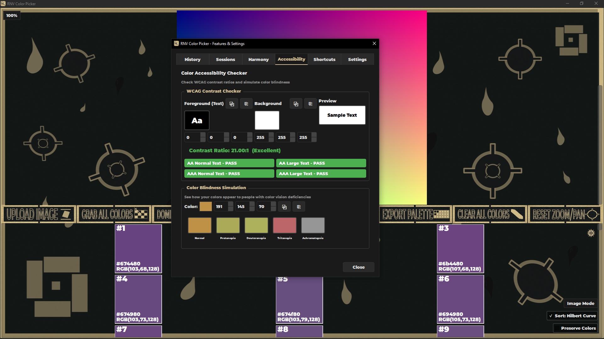
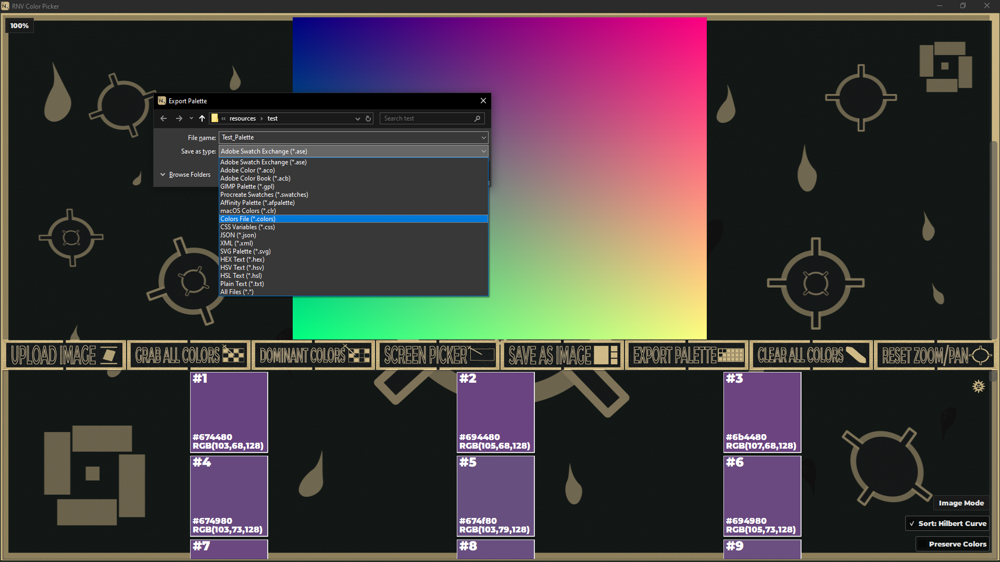

# RNV Color Picker

> Professional color extraction and palette management for designers and developers.

<p align="center">
  
</p>


[](https://github.com/RNVizion/rnv-color-picker/actions/workflows/tests.yml)

A polished PyQt6 desktop application for extracting, organizing, and exporting colors from any source — uploaded images, the screen under your cursor, or hand-picked regions. Built around a strict modular architecture (core / ui / utils), a centralized theming system with three modes, and an aggressive caching layer that keeps the UI responsive at the default limit of 333 colors.

---

## Highlights

- **Three color-acquisition workflows** — image extraction (upload or drop an image, then pick, select or grab every color), k-means dominant-color clustering, and a fullscreen screen picker with magnified pixel preview.
- **17 palette export formats, 16 import formats** — Adobe `.ase` and `.aco`, GIMP `.gpl`, Affinity, Procreate `.swatches`, Apple `.clr`, plus JSON, XML, CSS, SCSS, SVG, and more.
- **Three theme modes** — Dark, Light, and Image (custom backgrounds with translucent overlays).
- **Performance-engineered** — paint events cut from 500ms → 65ms, color refresh from 1.7s → 65ms via widget recycling, LRU pixmap cache, and stylesheet/QColor caches.
- **Branch coverage measured on every run** across over 1,900 tests (unittest + pytest with hypothesis property-based testing and real Qt threading verification).

## Screenshots

<p align="center">
  <br>
  <em>Three theme modes — Dark, Light, and Image (with translucent overlays on a custom background)</em>
</p>

<table>
  <tr>
    <td align="center">
      <br>
      <em>Screen picker with 8× magnifier overlay</em>
    </td>
    <td align="center">
      <br>
      <em>Shift+drag region color extraction</em>
    </td>
  </tr>
  <tr>
    <td align="center">
      <br>
      <em>K-means dominant-color clustering</em>
    </td>
    <td align="center">
      <br>
      <em>Settings panel — six tabs covering history, sessions, harmony, accessibility</em>
    </td>
  </tr>
  <tr>
    <td align="center" colspan="2">
      <br>
      <em>Multi-format palette export — 17 formats including ASE, ACO, GPL, JSON, CSS, SCSS</em>
    </td>
  </tr>
</table>

## Features

**Color extraction**
- Load an image with Upload Image (`Ctrl+O`) or by dropping a file on the window or the image view. PNG, JPG and JPEG load; anything else is refused with a message.
- Double-click a pixel to add its color; Shift+drag to add every unique color in a region (more than 5 image pixels each way); Grab ALL Colors (`Ctrl+G`) for every unique color in the image
- Zoom with the mouse wheel, and pan a zoomed image with a plain drag; Reset Zoom/Pan (`Ctrl+0`) fits the image again. Right-click the image for Clear Image and Lock/Unlock Zoom (a locked view ignores the wheel and shows a gold border).
- Screen color picker with magnified pixel-level preview, works anywhere on screen
- Dominant color extraction via k-means clustering (2 to 33 colors, asked each time)
- Color history with timestamps, persistent across sessions

**Palette management**
- Lock individual colors (right-click a swatch) to keep them through Clear All Colors and new extractions; a locked swatch has a gold border
- Hilbert-curve perceptual sorting, or HSL: the **Sort** checkbox at the bottom right switches between them
- **Preserve Colors** checkbox: new extractions add to the palette instead of replacing it
- Up to 333 colors per palette by default; **Maximum Colors** in Settings sets the limit from 1 to 1000
- Per-color context menu: copy as HEX / RGB / HSL, remove, lock
- Save As Image (`Ctrl+S`) writes the whole palette as a 2550 × 3300 px PNG or JPEG sheet (8.5 × 11 in at 300 dpi), three swatches to a row, each with its number, HEX and RGB
- The theme button at the bottom right cycles Dark, Light and Image

**Palette files**
- Export (`Ctrl+E`): 17 formats, chosen by the file's extension
  - Adobe Swatch Exchange (`.ase`), Photoshop (`.aco`), Adobe Color Book (`.acb`)
  - GIMP (`.gpl`), Affinity (`.afpalette`), Procreate (`.swatches`), Apple (`.clr`)
  - JSON, XML, CSS variables, SCSS variables (`$color-1: #rrggbb;`), SVG swatch sheet
  - Plain text (`.txt`, `.colors`, `.hex`, `.hsl`, `.hsv`)
  - Formats that store a weight write 50 for every color
- Import (`Ctrl+I`, or right-click an empty part of the palette): the same formats except `.acb`, 16 in all. With colors already in the palette, it asks whether to replace them or add to them (replacing keeps locked colors, and with Preserve Colors on it adds); duplicates are skipped and Maximum Colors is kept.

**Color science** (Settings panel)
- WCAG AA/AAA contrast checker for normal and large text, each marked PASS or FAIL, with copy and paste (HEX) buttons for the foreground and background colors
- Color blindness simulation of one color: normal vision, protanopia, deuteranopia, tritanopia, achromatopsia
- Color harmony generator (complementary, triadic, tetradic, analogous, split-complementary, monochromatic, compound); **Pick from Palette** takes the palette's first color as the base, and **Add All to Palette** adds the harmony

**Sessions and persistence**
- Save and load named workspace sessions (`.cpksession`) in the Settings panel's Sessions tab
- Auto-save every 6 minutes and on close (Settings: Auto-save session on exit, on by default). If the app did not close properly, the next launch offers to restore the colors it auto-saved; the auto-save is kept whatever the answer.
- **Auto-load last session on startup** loads the session saved, auto-saved or loaded most recently (the first in the recent-sessions list)
- Recent sessions list, deletable per-entry
- History export as JSON or TXT

**Themes**
- Image mode (custom backgrounds + translucent overlays), Dark mode and Light mode. The app starts in Image mode when `resources/background_images/background.png` exists or at least three of the main buttons have images, as they do in this repository; otherwise in Dark mode. The mode you pick with the theme button is remembered.
- Brand-gold accent system; the colors are kept as described in [Changing a color](#changing-a-color)

**Settings panel** (`Ctrl+,` or `Ctrl+P`, or the gear at the top right of the palette) has six tabs:
- **History**: recently picked colors; double-click one to add it to the palette; Clear History, Export History, Refresh
- **Sessions**: Save Current, Load Selected, Delete Selected, Refresh, and the auto-save and auto-load options
- **Harmony** and **Accessibility**: as above
- **Shortcuts**: the keyboard and mouse reference
- **Settings**: Default Theme, Auto-save session on exit, Auto-load last session on startup, Maximum Colors, Default Sort Method, Preserve colors, Default Export Format, Show tooltips (`F11`), Show debug dimension overlay (`F12`), Remember window size, Remember window position. **Apply** hands them to the window and keeps them, except the theme, which lasts until the app closes; **Save Settings** keeps them all and applies them; **Reset to Defaults** puts the defaults back in the tab.

Lowering Maximum Colors below the number of colors in the palette removes none of them: the app says so, keeps every color, and adds nothing new until the palette is under the limit.

**Default Export Format** is the format a save dialog opens on: GPL, ASE, JSON or CSS for Export Palette, PNG or JPEG for Save As Image. A name typed without an extension in that dialog takes the extension of the format chosen there. **Remember window size** (on by default) and **Remember window position** (off by default) keep the window's size and place from one close to the next launch; a saved place that is no longer on any screen is not used, and the window opens where it would by default.

## Tech Stack

| Layer | Technology |
|---|---|
| Language | Python 3.13 |
| GUI | PyQt6 6.10 |
| Image processing | Pillow, NumPy |
| ML | scikit-learn (`KMeans` for dominant color extraction) |
| Testing | pytest, pytest-qt, hypothesis, unittest |
| Coverage | coverage.py (with branch coverage) |

## Installation

**Requirements:** Python 3.13+ on Windows, macOS, or Linux.

```bash
# Clone the repo
git clone https://github.com/RNVizion/rnv-color-picker.git
cd rnv-color-picker

# Install what the app needs to run
pip install -r requirements.txt

# Run
python RNV_Color_Picker.py
```

To run the tests as well, set up as below: the test runner needs the dev requirements.

## Setting up for development

Two scripts at the repository root set up a checkout. Both install the same two files:
`requirements.txt`, which is what the app needs to run, and `tests/requirements-dev.txt`,
which adds the test tools and rnv-brand at the commit this repository pins.

```powershell
# Windows (PowerShell 7)
.\in.ps1                      # makes .venv with Python 3.13 if there is none, then installs
.\.venv\Scripts\Activate.ps1
```

```bash
# Linux or Codespaces
./in.sh                       # also installs the Qt system libraries with apt-get
```

rnv-brand is installed from GitHub at a pinned commit, so the second file needs `git` and
network access. Run the script again after any change that moves the pin; the
register-pin test fails while the installed brand is not the pinned one.

## Quick Start

1. **Launch** — `python RNV_Color_Picker.py`. With this repository's images the app starts in Image mode; the theme button at the bottom right cycles Dark, Light and Image.
2. **Load an image** — `Ctrl+O`, or drop a PNG, JPG or JPEG file on the window. Double-click any pixel to add its color, or Shift+drag to extract every unique color in a region. Drag to pan, scroll to zoom.
3. **Pick from anywhere on screen** — `Ctrl+Shift+C` opens a fullscreen overlay with an 8× magnifier. Click to capture, `Esc` to cancel.
4. **Export** — `Ctrl+E` opens the export dialog. Choose any of 17 formats; the file extension determines dispatch. `Ctrl+I` imports a palette file.

Full keyboard shortcut reference: the table below, the Shortcuts tab of the About dialog (`Ctrl+/`), and the Settings panel's Shortcuts tab.

## Changing a color

The app's colors live in `utils/colors.py`, but their values are not edited there.
`brand_map.json`, at the repository root, says where each one comes from: a name in
rnv-brand (such as `APP.accent`) or a value this app owns, with the reason.
`tools/sync_colors.py` writes the value on each of those lines, and writes `COLORS.md`, the
chart of this app's colors.

- **A color this app owns:** change its value in `brand_map.json`, then run
  `python tools/sync_colors.py`.
- **A brand color:** it changes in rnv-brand first. Move the pin in
  `tests/requirements-dev.txt`, reinstall (above), then run `python tools/sync_colors.py`.
  The diff of `utils/colors.py` shows exactly what moved. The `brand-sync` workflow does
  this every day and opens a pull request only when a color this app uses has moved.
- `python tools/sync_colors.py --check` writes nothing and exits 1 if the color file or
  `COLORS.md` is out of date. `tests/test_colors_in_sync.py` runs it on every test run, so
  a value edited by hand in `utils/colors.py` fails the suite until the map says the same.

A derived color, such as a lightened or translucent step of the gold, stays code in
`utils/colors.py` and follows its base.

**The images do not follow.** Button art, backgrounds and icons have the gold drawn into
their pixels. `ACCENT_IMAGES.md` lists every image that carries it; `tools/accent_images.py`
writes that list (`--check` writes nothing) and never changes an image.
`tests/test_accent_images.py` keeps the list current.

## Files the app keeps

Settings, sessions, history, presets and recent files are written atomically through
`utils/atomic_write.py`: the new content goes to a temporary file beside the real one, is
flushed to disk, and replaces the original in one step. A crash or a full disk during a
save leaves the old file or the new one, never half of each. Exports you ask for, such as
a palette file or an image, are not state and keep their own writers.
`tests/test_atomic_state_writes.py` lists every writer and fails if one writes in place.

Where they are:

| File | Windows | macOS | Linux |
|---|---|---|---|
| Settings (`settings.json`, with the window's size and place) | `%APPDATA%\ColorPicker\` | `~/Library/Application Support/ColorPicker/` | `~/.config/ColorPicker/` |
| Color history (`color_history.json`) | `%APPDATA%\RNVColorPicker\` | `~/Library/Application Support/RNVColorPicker/` | `~/.config/RNVColorPicker/` |
| Sessions, auto-saves, the recent list | `~\.rnv_color_picker\sessions\` | `~/.rnv_color_picker/sessions/` | `~/.rnv_color_picker/sessions/` |

Auto-saves are `autosave_<date>_<time>.cpksession`, one per run; a launch keeps the five newest of earlier runs. While the app runs, `.recovery_needed` in the same folder marks it as running; a normal close removes it, and the restore offer looks for it.

## Project Structure

```
rnv-color-picker/
├── RNV_Color_Picker.py          # Application entry point and main window
├── brand_map.json                # Where each color comes from: rnv-brand or the app
├── COLORS.md                     # This app's color chart, written by the sync
├── ACCENT_IMAGES.md              # Every image with the gold drawn in, written by tools/accent_images.py
├── core/                         # Pure logic — no UI dependencies
│   ├── color_math.py             # RGB/HSV/HSL/Lab/RYB conversions, blending algorithms
│   ├── color_collection.py       # Palette container with weight metadata
│   ├── color_harmony.py          # Harmony generators
│   ├── color_history.py          # Persistent timestamped color history
│   ├── accessibility.py          # WCAG contrast, color-blindness simulation
│   ├── palette_formats.py        # Export to 17 file formats, import from 16
│   ├── screen_color_picker.py    # Fullscreen magnifier overlay
│   ├── hilbert_curve.py          # Perceptual color sorting
│   └── workers.py                # QThread workers (extraction, dominant colors, image load)
├── ui/                           # PyQt6 widgets and dialogs
│   ├── settings_panel.py         # Six-tab settings dialog
│   ├── about_dialog.py           # About, Features, Shortcuts and Credits tabs
│   ├── color_swatch_widget.py
│   ├── image_viewer.py           # QGraphicsView: zoom, pan, Shift+drag select, drop
│   ├── image_button.py           # Image-mode-aware button
│   ├── progress_dialog.py
│   ├── transparent_scroll_widget.py
│   └── widget_pool.py            # Widget recycling for fast palette refresh
├── utils/                        # Cross-cutting utilities
│   ├── colors.py                 # The colors, written by tools/sync_colors.py
│   ├── config.py                 # Paths, constants, theme state
│   ├── atomic_write.py           # Writes the files the app keeps, atomically
│   ├── logger.py                 # Color-coded structured logging
│   ├── error_handler.py          # Centralized exception handling
│   ├── signal_manager.py         # Tracked Qt signal connections (leak-free cleanup)
│   ├── settings_manager.py       # JSON-backed user preferences
│   ├── session_manager.py        # Workspace save/load, auto-save, the restore offer
│   ├── cache.py                  # ColorCache, QColorCache, StylesheetCache, FontCache
│   ├── pixmap_cache.py           # LRU pixmap cache for image zoom
│   ├── async_file_ops.py         # QThread-based file I/O
│   ├── clipboard.py              # Cross-platform clipboard helpers
│   ├── dialog_helper.py          # Themed message boxes
│   ├── file_utils.py             # Safe file operations
│   └── font_loader.py            # Custom font loading with fallbacks
├── resources/
│   ├── icons/                    # Application icon
│   ├── fonts/                    # Embedded Montserrat-Black
│   ├── button_images/            # Image-mode button graphics
│   ├── background_images/        # Image-mode backgrounds
│   └── screenshots/              # The pictures in this README
├── tools/
│   ├── sync_colors.py            # Writes the colors in utils/colors.py, and COLORS.md
│   └── accent_images.py          # Writes ACCENT_IMAGES.md
├── .github/workflows/
│   ├── tests.yml                 # CI: the two suites, on Ubuntu and Windows
│   └── brand-sync.yml            # Daily: colors from rnv-brand; a pull request only if one moved
├── in.sh, in.ps1                 # Set up a checkout (Linux, Windows)
├── requirements.txt              # What the app needs to run
├── pyproject.toml                # Packaging (pip install .)
├── run_tests.py                  # Both suites under coverage, merged
├── pytest.ini, conftest.py, .coveragerc
├── RNV_Color_Picker.spec         # PyInstaller spec
├── build_windows.bat, build_linux.sh            # Standalone builds with PyInstaller
├── clean_python_cache.bat, clean_python_cache.sh  # Remove caches and build output
├── RNV_Color_Picker.pyproj       # Visual Studio project
├── tests/                        # pytest tests (test_*.py), conftest.py, color_values.py
│   └── requirements-dev.txt      # Test tools and the rnv-brand pin
├── test_rnv_color_picker.py      # unittest tests (legacy harness)
├── TESTING.md, CHANGELOG.md, LICENSE
```

## Testing

The project carries over 1,900 tests across two harnesses:

| Harness | Tests | Notes |
|---|---|---|
| `unittest` | over 300 | Legacy regression suite |
| `pytest` | over 1,500 | Modern suite — hypothesis property tests, pytest-qt for real Qt threading and the main window |
| **Total** | **over 1,900** | Branch coverage enabled |

**Run the full suite** (after setting up as above):

```bash
python run_tests.py
```

This runs both harnesses sequentially and produces a combined coverage report.

Coverage is measured on every full run. `python run_tests.py --report` prints the current
figure for every module; it differs a little between Windows and Linux. CI prints the
combined report after every run; this repository's workflow sets no floor (`--fail-under`).

A detailed write-up of the test architecture, the guard tests, banked patterns, and bug-discovery history is in [TESTING.md](TESTING.md).

## Engineering Notes

### Cross-project bug discovery

A platform-dependent palette output bug was found here via cross-project comparison while debugging snapshot test failures in [RNV Color Mixer](https://github.com/RNVizion/rnv-color-mixer). Color Mixer's snapshot suite uses byte-level file comparison, which surfaced the issue immediately: every text-format palette export written on Windows contained different bytes than the same export written on Linux/macOS, because Python's default text-mode `open()` substitutes `\r\n` for `\n` on Windows only.

Color Picker has **no snapshot test suite**, so the same bug existed here undetected. Palette files generated on Windows would round-trip fine in any text editor and parse identically when re-imported, but their byte content differed from non-Windows output — meaning palette files shared between platforms produced inconsistent results when consumed by tools that rely on exact byte matching (signed manifests, version-controlled palettes, content hashes, snapshot tests in downstream projects).

The fix was applied to all text-format export methods in three patterns:

- **Simple text writes** — added `newline='\n'` to `open(...)` calls so Python skips the Windows-only CRLF substitution
- **JSON writes** — same fix applied to the methods that emit JSON-encoded palettes
- **ElementTree XML and CLR exports** — switched to binary mode with explicit file objects so the writer controls line endings directly

Three more bugs, in the Adobe binary formats, were fixed the day before: ASE color names now end with the UTF-16 null terminator and each color block states its length correctly (it was 22 bytes plus the name; it is 20), so Photoshop and Illustrator read the files; the ACO name-length field is written as the 4-byte value the format specifies, not 2 bytes; and ACO import rounds 16-bit channels to 8-bit instead of truncating, so a Photoshop-written file no longer comes in one step dark per channel.

The methodology — using one project's stronger test infrastructure to surface latent bugs in *sibling* projects that share design patterns — is now a documented part of how the RNVizion suite stays consistent. When a bug is found in one project, the fix isn't just ported; the entire family is audited for the same shape of error.

For the full audit history including affected methods and verification approach, see [CHANGELOG.md](CHANGELOG.md).

## Architecture Highlights

**Centralized colors (`utils/colors.py`)** — every color in the app comes from one file, whose values `tools/sync_colors.py` writes from `brand_map.json` and the pinned rnv-brand (see [Changing a color](#changing-a-color)). Theme dicts (`DARK_THEME_COLORS`, `LIGHT_THEME_COLORS`, `IMAGE_MODE_COLORS`) are referenced by key throughout the codebase; brand colors (`BRAND_GOLD`, `BRAND_DARK_GOLD`) are typed as `Final[str]`. Any hardcoded color elsewhere is a bug.

**Signal lifecycle management (`utils/signal_manager.py`)** — every Qt signal connection is registered with a `SignalConnectionManager`, tagged with a `track_as` label, and disconnected on widget close. Eliminates the leak-then-crash class of PyQt bugs.

**Multi-tier caching (`utils/cache.py`, `utils/pixmap_cache.py`)** — LRU caches for `QColor` instantiation, RGB↔HSL conversion, stylesheet strings, fonts, and zoomed pixmaps. Hit-rate metrics exposed via `get_stats()`. Backing the 500ms → 65ms paint event speedup.

**Widget recycling (`ui/widget_pool.py`)** — color swatch widgets are pooled and re-configured rather than destroyed/recreated on palette refresh. Backing the 1.7s → 65ms refresh speedup at 333 colors.

**Progress for long operations (`ui/progress_dialog.py`)** — Grab ALL Colors and Dominant Colors show a progress dialog while they analyze the image; Grab ALL shows one with a Cancel button while it adds more than 50 colors, and loading a session of more than 100 colors shows one while the swatches are built. Image loads, palette exports and saves run on the main thread.

## Keyboard Shortcuts

| Key | Action |
|---|---|
| `Ctrl+O` | Open / upload image (PNG, JPG, JPEG) |
| `Ctrl+S` | Save the palette as an image sheet (PNG or JPEG) |
| `Ctrl+E` | Export palette |
| `Ctrl+I` | Import palette |
| `Ctrl+G` | Grab all colors from image |
| `Ctrl+K` | Extract dominant colors (k-means) |
| `Ctrl+Shift+C` | Screen color picker |
| `Ctrl+D` | Clear all colors (locks preserved) |
| `Ctrl+0` | Reset zoom and pan |
| `Ctrl+,` or `Ctrl+P` | Open settings & features panel |
| `Ctrl+/` | Open About dialog |
| `F11` | Toggle tooltips |
| `F12` | Toggle debug overlay |
| `Mouse wheel` | Zoom image |
| `Click + drag` | Pan image |
| `Double-click` | Pick color from pixel |
| `Shift + drag` | Select region for extraction |
| Drop a file | Load it (PNG, JPG, JPEG) |
| Right-click the image | Clear Image, Lock/Unlock Zoom |
| Right-click a swatch | Copy as HEX / RGB / HSL, Remove Color, Lock/Unlock Color |
| Right-click the palette | Import Palette |

## Roadmap

- [ ] Web-deployable Wasm build (Pyodide / PyQt-WebAssembly)
- [ ] Plugin system for custom export formats
- [ ] Cloud session sync (optional, opt-in)
- [ ] Mutation testing (mutmut) on `core/` modules

## Related Projects

Part of the RNVizion suite of color tools:

- **[RNV Color Mixer](https://github.com/RNVizion/rnv-color-mixer)** — Bringing real-world paint mixing to the digital palette.
- **[RNV Color Palette Manager](https://github.com/RNVizion/rnv-color-palette-manager)** — Professional desktop application for creating, managing, and exporting color palettes.

## License

[MIT](LICENSE) — free to use, modify, and distribute.

The bundled fonts are not under MIT. Montserrat Black (the mark), Inter (the interface) and JetBrains Mono (fixed-width text) are under the SIL Open Font License 1.1, and each family's license travels with it in `resources/fonts/`: [`OFL-Montserrat.txt`](resources/fonts/OFL-Montserrat.txt), [`OFL-Inter.txt`](resources/fonts/OFL-Inter.txt) and [`OFL-JetBrains-Mono.txt`](resources/fonts/OFL-JetBrains-Mono.txt). Inter and JetBrains Mono are made from rnv-brand's files at the pinned commit by `python tools/sync_fonts.py`, one TrueType file per weight; `tests/test_fonts_in_sync.py` fails when the copy and the pin disagree.

## Author

Built by [RNVizion](https://github.com/RNVizion)

---

<p align="center">
  Built with PyQt6 · over 1,900 tests · branch coverage on every run
</p>
